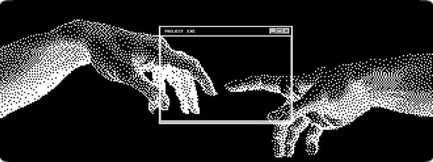
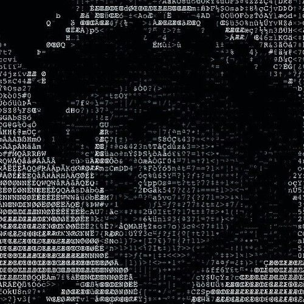

  

<h2 align="center">Hi 👋, I'm Hafis</h2>

<h3>Full-Stack & Web3 Developer</h3>

<code>learn. build. repeat.</code>

  

Learning by building, one project at a time.

 

<h2 align="center">🚀 About Me</h2>

<table>
<tr>
<td valign="top" width="62%">

**Hafis**, here — a Software Engineering student from Indonesia, focused on Java and web development.

I'm one year into coding and learn best by building small projects and iterating on them.

Currently learning **HTML, CSS, and JavaScript**, while strengthening my foundation in **Java (OOP, Collections, HashMap)**. I'm also exploring **cybersecurity** and **Web3**.

My goal is simple: write clean code, ship real projects, and grow into a full-stack developer.

</td>
<td valign="middle" align="center" width="38%">

</td>
</tr>
</table>

<h2 align="center">🤝 Connect</h2>

  
  
  
  

<h2 align="center">💻 Tech Stack</h2>

  

<h2 align="center">📊 GitHub Stats</h2>

  

  
  

<h2 align="center">📈 Activity Graph</h2>

  

  Leveling up one project at a time.

