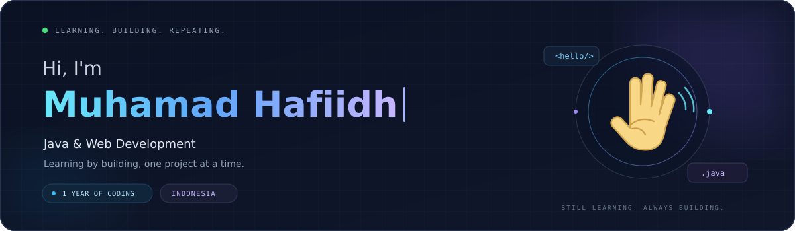

  

  <b>Student Developer · Java &amp; Web · Indonesia 🇮🇩</b>

<samp>Java &amp; Web Development · Full-Stack Developer in Progress</samp>

##  About Me

<table>
<tr>
<td width="55%" valign="middle">

<ul>
  <li>👋 I'm <b>Muhamad Hafiidh</b> — you can call me <b>Hafis</b>.</li>
  <li>💻 <b>1 year of coding</b>, learning through practice and projects.</li>
  <li>☕ Started with <b>Java</b>: OOP, Collections, and HashMap.</li>
  <li>🌱 Currently learning <b>web development</b> with HTML, CSS, and JavaScript.</li>
  <li>🚀 Future goals: <b>Web3, Mobile, Cyber Security, and OS Development</b>.</li>
  <li>📍 From <b>Indonesia 🇮🇩</b>.</li>
</ul>

</td>
<td width="45%" valign="middle">

</td>
</tr>
</table>

##  Languages and Tools

   &nbsp;
   &nbsp;
   &nbsp;
   &nbsp;
   &nbsp;
   &nbsp;
   &nbsp;
  

Main focus: Java, HTML, CSS, and JavaScript. Also exploring Python, C++, and database fundamentals.

##  My Statistics

<table>
<tr>
<td width="57%" valign="top">

  

</td>
<td width="43%" valign="top">

</td>
</tr>
</table>

 

<b>🎮 Player Card · Skill Tree · Quest Log · Projects · Achievements</b>

 

## 🕹️ PLAYER CARD

| Attribute | Player data |
| :--- | :--- |
| **PLAYER** | Muhamad Hafiidh |
| **ALIAS** | Hafis |
| **CLASS** | Full-Stack Developer in Progress |
| **CURRENT QUEST** | 🌐 Web Development |
| **SECONDARY QUEST** | 🛡️ Cyber Security |
| **FUTURE PATHS** | Web3 · Mobile · System / OS |
| **EXPERIENCE** | ⚡ 1 year of coding |
| **STATUS** | 🟢 Learning & building |

> Satu tahun belajar coding. Mulai dari Java, sekarang mengembangkan kemampuan web lewat proyek dan latihan.

---

## 🌳 SKILL TREE

| Path | Skills & topics | Quest status |
| :--- | :--- | :--- |
| 🌐 **WEB DEVELOPMENT** | HTML · CSS · JavaScript | 🔵 Active quest |
| ☕ **PROGRAMMING** | Java · OOP · Collections · HashMap | 🟣 Core path |
| ⛓️ **WEB3** | Exploring the ecosystem | 🔒 Future quest |
| 🛡️ **CYBER SECURITY** | Networking · Linux · Security fundamentals | 🔒 Future quest |
| 📱 **MOBILE** | Mobile development | 🔒 Future quest |
| 🖥️ **SYSTEM / OS** | Linux & OS fundamentals | 🔒 Future quest |

  

## 🎒 INVENTORY — Tech Stack

  

 

| Currently Learning | Exploring Next | Future Quest |
| :--- | :--- | :--- |
| HTML & CSS | Backend Development | Cyber Security |
| JavaScript | Linux Fundamentals | Web3 |
| Java & OOP | Mobile Development | System / OS |
| Responsive Layout | Database Integration | Full-Stack Architecture |

---

## 📜 QUEST LOG

- [x] Learn HTML fundamentals
- [x] Learn CSS fundamentals
- [x] Learn Java Collections — HashMap
- [ ] Improve JavaScript
- [ ] Build more web projects
- [ ] Learn backend development
- [ ] Explore Cyber Security
- [ ] Explore Mobile Development
- [ ] Learn Linux / OS fundamentals
- [ ] Explore Web3

  

---

## 🎮 MISSION SELECT — Projects

<table>
<tr>
<td width="50%" valign="top">

<h3>🏥 MISSION 01</h3>

<b>Hospital Website</b>

  

Website project built with HTML, CSS, and JavaScript.

<code>HTML</code> <code>CSS</code> <code>JavaScript</code>

  

</td>
<td width="50%" valign="top">

<h3>🔒 MISSION 02</h3>

<b>Next Project — TBD</b>

  

Slot untuk proyek berikutnya.

<code>New idea</code> <code>New challenge</code>

<i>Next quest loading...</i>

</td>
</tr>
</table>

---

## 🏆 ACHIEVEMENTS

| 🔓 Unlocked | 🔒 Future achievements |
| :--- | :--- |
| 🌐 First Website | Backend Master |
| 🎨 CSS Unlocked | Cyber Security |
| ⚡ JavaScript Initiated | Full-Stack |
| ☕ Java Collections | System Architect |
| 🎮 One Year of Coding | Web3 Builder |

  

---

## ⚡ XP SYSTEM

| Action | Reward |
| :--- | :---: |
| 💻 Write code | +XP |
| 🚀 Build a project | +XP |
| 📖 Learn something new | +XP |
| 🐛 Debug an error | +XP |

  <b>Every project adds experience.</b> 
  Progress comes from the code I write, understand, and improve.

---

## 📡 Connect With Me

  
  
  
  

  <i>🎮 Leveling up one project at a time.</i> 
  Muhamad Hafiidh · One year in. Still building.

